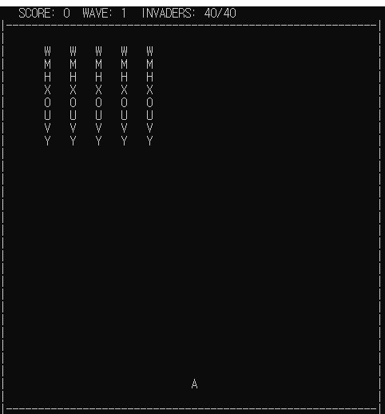

# 게임루프
    - 게임 루프란 입력이 있든 없든 게임이 실행중일때 지속적으로 실행되는것 입니다.

## 무엇을
    - 게임 루프를 입력, 갱신, 렌더링을 프레임 (한 바퀴)로 표현한 것이다.

    - 입력은 이벤트로 만들어줘
    - 갱신은 delta time 표현하도록 구성해라
    - 화면을 그려줘(render)

## 무슨 문제가 발생했나요?
    - 생각보다 전투 공간보다 개체가 적어서 난이도가 낮아서 문제

    

## 왜
    - 어떤 해택을
    - 그러면 이거는 어떻게 해야될까요?

## 실습
    - 게임 루프. 용어들을 총 동원해서 게임을 만드셔야 합니다.
    - 똥피하기, 스네이크 게임, wasd 탑뷰 (움직이고 피하는 게임)